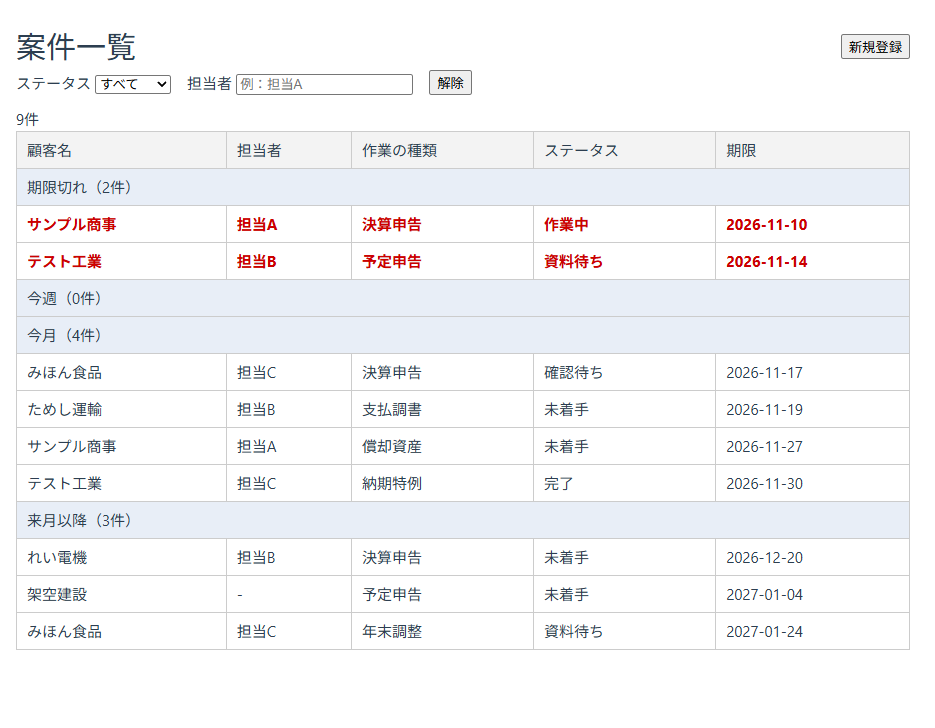
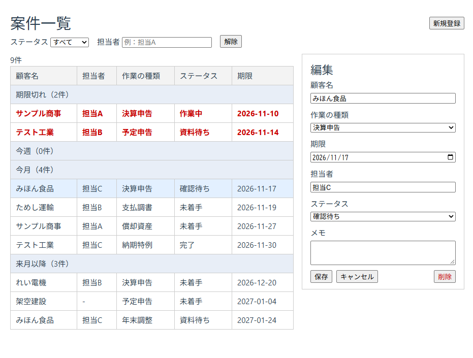
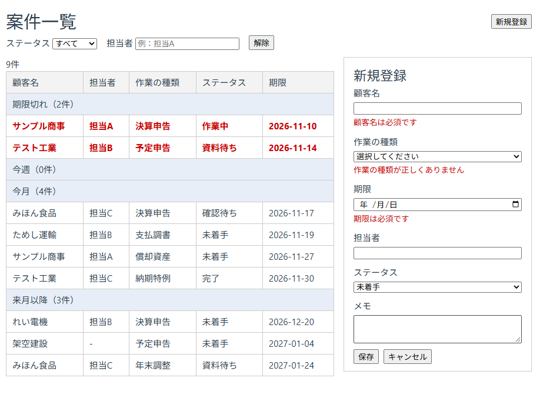

# case-manager（案件・期限管理アプリ）

税理士事務所で、決算・年末調整などの進捗を約300列の横長Excelで管理していた経験をもとに、
「顧客・作業・期限」を整理して管理するWebアプリとして作り直した学習プロジェクトです。

## 作った理由
前職ではExcelで一元管理していたため、「いま対応が必要なもの」を探すのが大変でした。たとえば、自分の担当で今月対応するものを探すとき、決算の前後で11月・12月・1月、さらに年末調整など、複数の行や列を見て回る必要があり、絞り込みが難しい状態でした。タスクの管理も、Excelとは別に自分で行う必要がありました。

そこで、このアプリでは「タスク」に集中し、担当者・ステータスで絞り込み、期限で「期限切れ／今週／今月／来月以降」に区切ることで、対応漏れを防ぎやすくしました。顧客全体の管理は、タスクに集中するため、このアプリにはあえて入れていません（2週目以降に、顧客マスタとして別に作る予定です）。

また、Excelには結果しか残らず、細かい記録を残すことや、共有することができませんでした。変更履歴の記録や共有は、今後の課題として取り組みたいと考えています。

### 作ってみて学んだこと
- テストを書き、わざとコードを壊して赤くなることを確かめることで、コードが正しく書けているかを確認する方法を学びました
- バックエンドをテストで確かめてから、フロントエンドを作ったので、画面がうまく動かないときに、問題が画面側にあると絞り込めました
- Vueは経験が薄かったため、画面の動きを確認しながら進めることで、コードの意味を理解できました

## 機能
- 案件の登録・一覧・更新・削除（一覧の行を押すと、右側のパネルで編集。削除は確認つき）
- ステータス・担当者での絞り込み
- 期限の早い順の並び（API側）と、「期限切れ／今週／今月／来月以降」の4つの区切り表示（画面側）
- 期限切れの未完了案件は、赤字・太字で強調。期限が過ぎた完了案件は、「完了」で絞り込んだときだけ表示
- 入力チェック（必須・文字数・作業の種類）。エラーは入力欄の下に表示
- 削除済みの案件を更新・削除しようとすると、404を受けて「この案件はすでに削除されています」と表示

## 技術
| 区分 | 使っているもの |
|---|---|
| バックエンド | Java 21 / Spring Boot / Spring Data JPA / Bean Validation |
| DB | H2（ファイル保存。`backend/data/` に作られます） |
| フロントエンド | Vue 3 / Vite / TypeScript |
| テスト | JUnit 5 / MockMvc（APIの自動テスト） |

## 構成
```
backend/    Spring Boot（API。http://localhost:8080）
frontend/   Vue 3 + Vite（画面。http://localhost:5173。/api は 8080 へ取り次ぐ）
docs/       設計・計画・学習記録
```

## API
| やること | メソッド | URL |
|---|---|---|
| 一覧を取る（期限の早い順。`status`・`assignee` で絞り込み可） | GET | /api/cases |
| 1件を取る | GET | /api/cases/{id} |
| 登録する | POST | /api/cases |
| 更新する | PUT | /api/cases/{id} |
| 削除する | DELETE | /api/cases/{id} |

入力が正しくないときは 400（項目ごとのメッセージつき）、存在しないidは 404 を返します。

## 起動手順
### 必要なもの
- JDK 21（`JAVA_HOME` を JDK 21 のフォルダに設定するか、`java` に PATH を通しておく。`./gradlew` は Java をここから探します。`JAVA_HOME is not set` と出たら、この設定が未了です）
- Node.js 22.18 以上、または 24.12 以上

### 1. バックエンド（1つ目のターミナル）
```bash
cd backend
./gradlew bootRun
```
Windows のコマンドプロンプトでは `gradlew.bat bootRun` です。
初回の起動で、DBファイル（`backend/data/`）が作られ、**架空のサンプルデータ10件**が入ります（案件が0件のときだけ）。

### 2. フロントエンド（2つ目のターミナル）
```bash
cd frontend
npm install
npm run dev
```
表示されたURL（通常は http://localhost:5173 ）をブラウザで開きます。

### テストと型チェック
```bash
cd backend
./gradlew test
```
```bash
cd frontend
npm run type-check
```

## 画面
### 一覧（期限で4つに区切り、期限切れは赤字）


### 編集（行を押すと、右側にパネルが開く）


### 入力チェック（エラーは入力欄の下に表示）


最初に紙で描いた設計：[一覧](docs/screens/list.jpg) / [登録・編集](docs/screens/form.jpg)
（実装の過程で変えた部分があります。例：編集時も顧客名を変更できるようにしました）

## 設計
[docs/design.md](docs/design.md)

## 今後の改善
- 顧客・担当者・作業の種類を別テーブルにして、FKで連携する
- 担当者マスタの論理削除と、顧客の担当履歴
- 案件の削除を論理削除にする（間違って消したときに戻せるように）
- 同時編集のぶつかりを検出する（楽観的ロック）
- 案件の自動作成と、作業ステップの管理
- MySQL（Docker）への切り替え

※ サンプルデータはすべて架空です。
